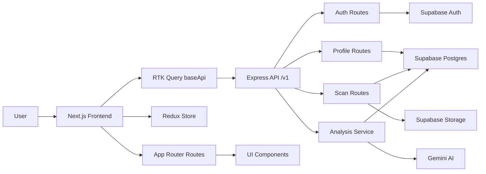
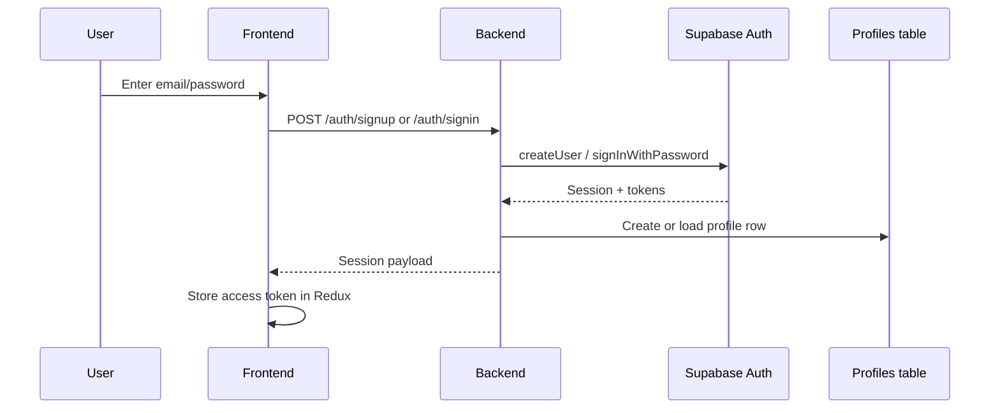
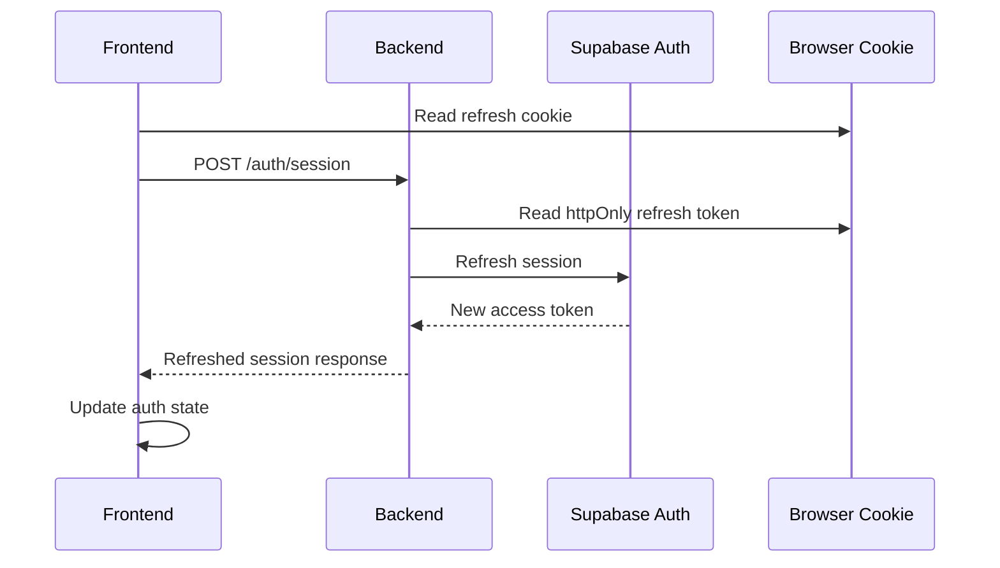
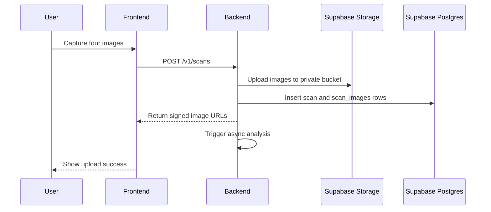
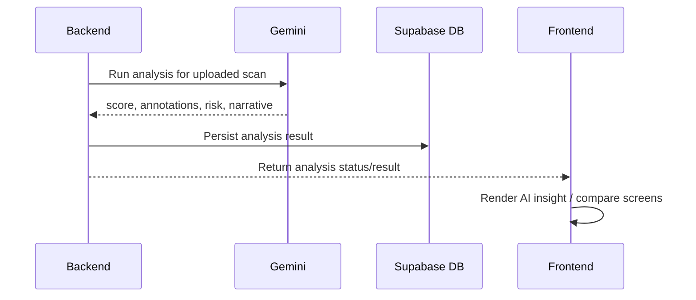
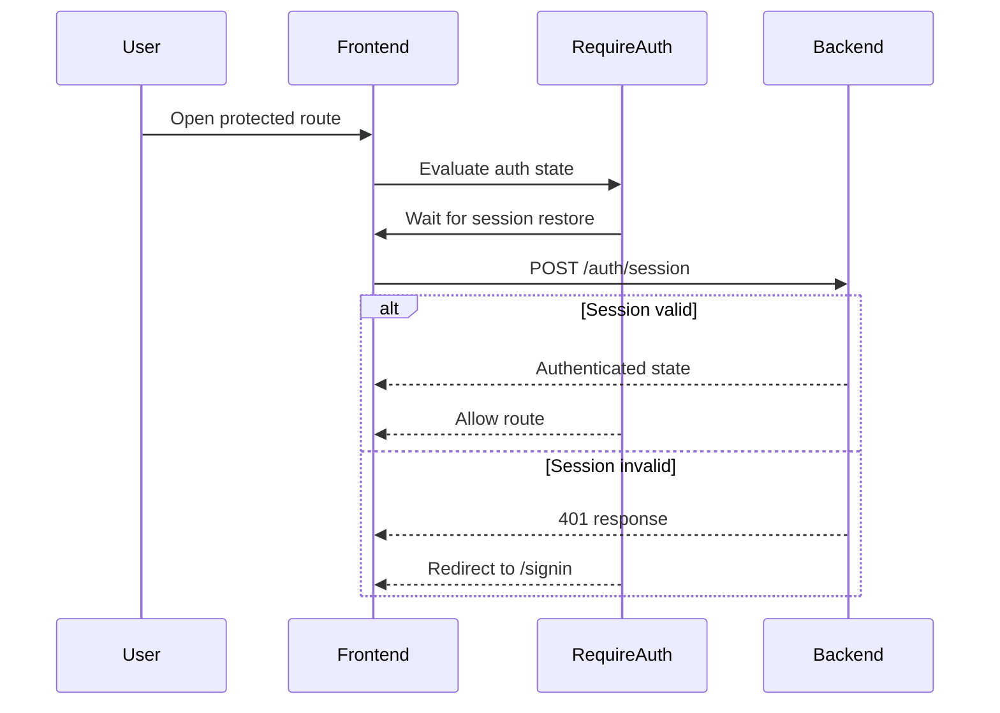

# DentaVue Flow Diagram (Developer Version)

## 1. High-level component interaction



---

## 2. Login / signup flow



---

## 3. Session restore flow



---

## 4. Guided scan upload flow



---

## 5. AI analysis flow



---

## 6. Protected route flow



---

## 7. API mapping

```text
Frontend feature modules
  - auth
  - profile
  - scan
  - analysis
  - onboarding
  - dashboard

       |
       v
RTK Query baseApi
       |
       +--> /v1/auth
       +--> /v1/profile
       +--> /v1/scans

Backend modules
  - routes/v1
  - controllers
  - services
  - models
  - middleware
  - validators
  - integrations
```

---

## 8. Developer notes

- Frontend uses a single RTK Query instance (`baseApi`) for cache consistency.
- Backend is the only service that talks to Supabase directly.
- Scan images are stored in a private Supabase Storage bucket.
- Signed URLs are returned to the browser for image rendering.
- AI analysis is asynchronous and the UI polls for status.
- Session persistence depends on an httpOnly refresh cookie.

---

## 9. Very short version

```text
User -> Frontend -> Backend -> Supabase / Gemini -> Frontend
```

This means:
- Frontend handles screens and user interaction.
- Backend handles logic, validation, and orchestration.
- Supabase handles auth, storage, and database.
- Gemini handles AI analysis.
