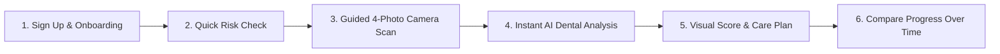

# 🦷 DentaVue — Product Overview & Application Functionality
*(Non-Technical Guide for Stakeholders, Product Teams & Demo Reviewers)*

**Live Application:** [https://www.dentavue.co.uk](https://www.dentavue.co.uk)

---

## 🌟 What is DentaVue?

**DentaVue** is an **AI-powered Dental Screening and Oral Health Tracking web application**. It allows anyone to use their smartphone or laptop camera to take guided photos of their teeth and gums from home, receive an instant **Oral Health Score (0–100)** with visual AI highlights showing areas that need attention, and track whether their dental health is improving over time.

> **Important Note:** DentaVue is designed as an educational screening and preventive awareness tool to help users monitor their daily oral care between dentist visits — not a replacement for a clinical dentist examination.

---

## 🧭 Step-by-Step User Journey

---

### 1. Easy Sign-Up & Personal Onboarding
- **Multiple Sign-In Options:** Users can sign in with their **Email & Password**, **Google Account (1-click)**, or **Mobile Phone OTP**.
- **Two User Roles:**
  - **Patient:** Takes dental scans, views AI oral health reports, and tracks progress.
  - **Dental Provider:** Designed for dentists/clinics to review patient profiles and care workflows.
- **3-Step Onboarding:** First-time users complete a short welcome walkthrough and fill in basic profile preferences in under 60 seconds.

---

### 2. Pre-Scan Oral Risk Check (`/guided-scan/risk-assessment`)
Before opening the camera, the app asks a few simple, non-technical questions about the user's mouth:
- Do your gums bleed when brushing?
- Do you feel tooth sensitivity to hot, cold, or sweet foods?
- How often do you brush and floss?

This gives the AI helpful context before looking at the photos.

---

### 3. Guided 4-Angle Camera Capture (`/guided-scan/capture`)
Instead of guessing how to take a photo, DentaVue guides the user step-by-step on screen to capture **4 clear angles of their mouth**:
1. **Front Teeth** — A full smile showing the upper and lower front teeth.
2. **Upper Gums & Teeth** — Tilting slightly back to show the upper gumline and arch.
3. **Tongue & Inner Mouth** — Showing the surface of the tongue and soft tissues.
4. **Lower Gums & Teeth** — Showing the lower gumline and inner teeth.

**Smart Built-In Camera Checks:**
- Automatically checks if the photo is **too dark** or **too blurry** before accepting it, asking the user to retake if needed so the AI gets a clear picture.
- Users can either use their **live camera** or **upload existing photos** from their phone gallery.

---

### 4. What the AI Looks For (6 Key Oral Health Areas)
Once the 4 photos are submitted, DentaVue's AI Vision engine inspects the photos across **6 everyday dental health indicators** to calculate a single **0–100 Oral Health Score**:

| # | Oral Health Indicator | Weight in Score | What It Means in Simple Terms |
|---|---|---|---|
| **1** | **Gum Redness & Swelling** *(Gum Inflammation)* | **25%** | Checks if the gums look healthy and pink, or red and puffy along the teeth. |
| **2** | **Plaque Buildup** *(Plaque Extent)* | **20%** | Checks for visible soft buildup on teeth where brushing may have missed. |
| **3** | **Receding Gums** *(Gum Margin Recession)* | **20%** | Checks if the gumline is pulling back and exposing more of the tooth root. |
| **4** | **Tooth Surface Wear** *(Enamel Wear)* | **15%** | Looks for flat edges, small chips, or grinding wear on the chewing surfaces. |
| **5** | **Tongue & Mouth Tissue** *(Tissue Appearance)* | **15%** | Checks the general appearance and cleanliness of the tongue and inner mouth. |
| **6** | **Tartar & Surface Stains** *(Calculus & Stain)* | **5%** | Looks for hardened tartar near the gumline or coffee/tea/food staining. |

### Why DentaVue's Score is Reliable (No Random AI Guessing)
Many AI tools give a different score every time you take a photo in slightly different lighting. DentaVue solves this by grouping findings into **4 clear levels** (**None**, **Mild**, **Moderate**, **Marked**) and using a consistent medical-style scoring rulebook. A clean, healthy mouth scores near **100**, and minor lighting changes won't cause confusing score jumps.

---

### 5. Clear Results & Visual Highlights (`/guided-scan/results` & `/ai-insight`)
Within seconds of completing a scan, the user receives an easy-to-read report:
- **Overall Oral Health Score (0–100):** A single clear number showing overall mouth health, plus whether it went up or stayed stable since the last scan.
- **Visual Boxes on Photos:** The app draws colored highlight boxes directly on the user's mouth photos to point out exact spots (for example, *"Mild plaque noticed on lower front teeth"*).
- **Simple Action Plan:** Plain-English tips tailored to the user's scan (e.g., *"Spend an extra 30 seconds brushing gently along the lower gumline"* or *"Consider scheduling a routine dental cleaning"*).

---

### 6. Side-by-Side Progress Comparison (`/compare`)
- Users can pick any two past scans (for example, **Last Month vs. Today**) and compare them side-by-side.
- Each of the 6 oral health areas is labeled as:
  - ✅ **Improved** — Habits are working!
  - ➖ **Stable** — Holding steady.
  - ⚠️ **Needs Attention** — Worth focusing on or showing to a dentist.

---

## 🔒 Privacy & Security at a Glance
- **Private Photo Storage:** Mouth photos are never public; they are stored in a private encrypted vault and viewed only through temporary secure links that expire after 1 hour.
- **Secure Camera Access (`HTTPS`):** All scans run over an encrypted HTTPS connection (`https://www.dentavue.co.uk`).

