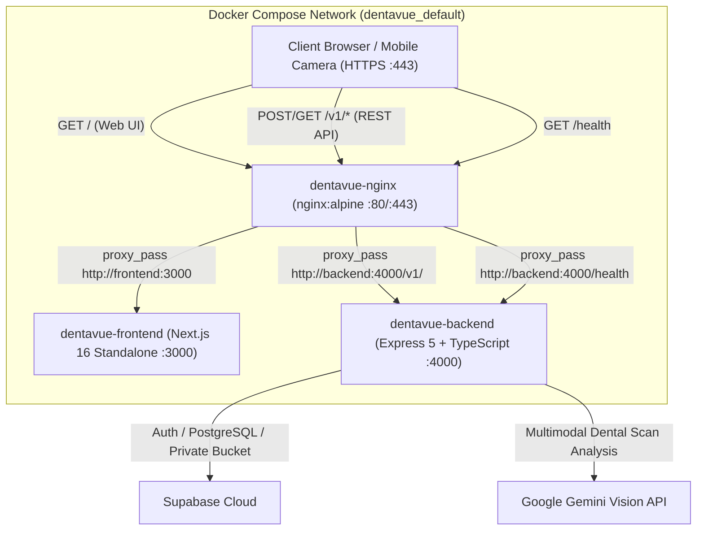
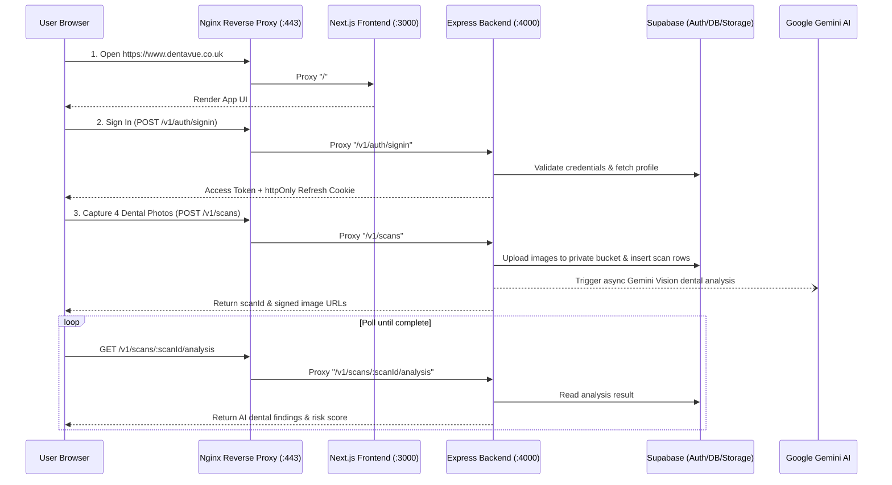
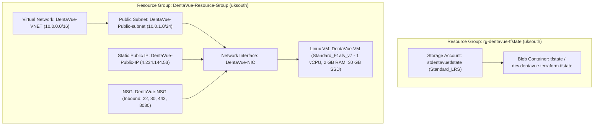

# 🦷 DentaVue — Complete Application & Cloud Infrastructure Documentation

**Live Production URL (HTTPS):** [https://www.dentavue.co.uk](https://www.dentavue.co.uk)  
**Alternate Domain (HTTPS):** [https://dentavue.co.uk](https://dentavue.co.uk)  
**Backend Healthcheck:** [https://www.dentavue.co.uk/health](https://www.dentavue.co.uk/health)  
**Azure Static Public IP:** `4.234.144.53` (`uksouth` — **Static SKU, never changes on VM shutdown/restart**)

### ⚡ Quick Emergency & VM Access Commands
```bash
# 1. SSH into Production Azure VM (run from repository root)
ssh -i Terraform/environment/dev/id_rsa_dentavue.pem azureuser@4.234.144.53

# 2. Start VM (after nightly 11:00 PM IST auto-shutdown — all containers auto-start on boot!)
az vm start --resource-group DentaVue-Resource-Group --name DentaVue-VM

# 3. Stop/Deallocate VM manually (to save compute billing when idle)
az vm deallocate --resource-group DentaVue-Resource-Group --name DentaVue-VM

# 4. Emergency One-Liner (if you ever want to manually restart all containers via SSH)
ssh -i Terraform/environment/dev/id_rsa_dentavue.pem azureuser@4.234.144.53 "cd ~/dentavue && sudo docker compose up -d && sudo docker compose ps"
```

DentaVue is a full-stack AI-assisted dental screening and guided intraoral scan web platform. This document serves as the **complete technical reference for both the Application Stack (Frontend, Backend, Docker, Nginx) and the Cloud Infrastructure (Azure + Terraform IaC)**.

> 💡 **Looking for a Non-Technical Product & Feature Overview?** See **[FUNCTIONALITY.md](./FUNCTIONALITY.md)** for a plain-English guide to what the app does and how users interact with it.

---

## 📑 Table of Contents

- **PART 1: APPLICATION & DOCKER DOCUMENTATION**
  1. [Application Overview & Layer Responsibilities](#1-application-overview--layer-responsibilities)
  2. [Core Runtime Flows (Auth, Guided Scan, AI Insights)](#2-core-runtime-flows)
  3. [Tech Stack & Repository Structure](#3-tech-stack--repository-structure)
  4. [Environment Variables Reference (`.env`)](#4-environment-variables-reference-env)
  5. [Multi-Stage Dockerfiles & Container Optimization](#5-multi-stage-dockerfiles--container-optimization)
  6. [Docker Compose & Nginx Reverse Proxy Routing](#6-docker-compose--nginx-reverse-proxy-routing)
  7. [Local Development & Testing Guide](#7-local-development--testing-guide)
  8. [Developer Playbook: How to Add Features or Re-Architect](#8-developer-playbook-how-to-add-features-or-re-architect)
- **PART 2: AZURE & TERRAFORM INFRASTRUCTURE DOCUMENTATION**
  9. [Azure Cloud Architecture](#9-azure-cloud-architecture)
  10. [Terraform Modular Design (`for_each` & `terraform.tfvars`)](#10-terraform-modular-design-for_each--terraformtfvars)
  11. [Remote State Backend (Azure Blob Storage)](#11-remote-state-backend-azure-blob-storage)
  12. [Cloud-Init Automated VM Bootstrap](#12-cloud-init-automated-vm-bootstrap)
  13. [Terraform Execution Commands](#13-terraform-execution-commands)
  14. [DNS Configuration & Let's Encrypt HTTPS (SSL)](#14-dns-configuration--lets-encrypt-https-ssl)
  15. [Production VM Operations, Troubleshooting & Cost Guide](#15-production-vm-operations-troubleshooting--cost-guide)

---

# PART 1: APPLICATION & DOCKER DOCUMENTATION

## 1. Application Overview & Layer Responsibilities

DentaVue is structured as a browser/mobile web application (`DentaVue-frontend`) communicating exclusively with a single REST API service (`DentaVue-backend`). The browser never talks directly to Supabase; the backend owns all Supabase credentials, authorization rules, signed storage URLs, and Google Gemini AI orchestration.



### Frontend Responsibilities (`DentaVue-frontend/`)
- Built on **Next.js 16 (App Router + Turbopack, `output: 'standalone'`)** and **React 19**.
- Uses **Redux Toolkit + RTK Query** (`src/services/api/baseApi.ts`) as the unified API layer.
- Stores access tokens in Redux memory only; session persistence relies on `httpOnly` refresh cookies managed by the backend (`credentials: 'include'`).
- Provides protected routes for patient onboarding, guided intraoral camera capture (`/guided-scan/capture`), real-time analysis polling (`/guided-scan/analysing`), AI insights (`/ai-insight`), and scan comparison (`/compare`).
- **Camera Security Requirement:** `/guided-scan/capture` uses `navigator.mediaDevices.getUserMedia()`, which browsers only permit in a **Secure Context (`https://` or `http://localhost`)**.

### Backend Responsibilities (`DentaVue-backend/`)
- Built on **Node.js 22**, **Express 5**, and **TypeScript**.
- Exposes `/v1/*` REST endpoints for authentication, user profiles, dental scan uploads, AI analysis, and scan comparisons, plus `/health` for container healthchecks.
- Enforces `zod` request validation, `helmet` security headers, `cors` origin checks, `express-rate-limit` throttling, and `pino` structured logging.
- Uploads captured dental images to a private Supabase Storage bucket (`scans`), generates signed URLs, and asynchronously invokes **Google Gemini Vision AI** (`gemini-3.5-flash-lite` with fallback models).

---

## 2. Core Runtime Flows



---

## 3. Tech Stack & Repository Structure

```text
denta-vue/
├── DentaVue-backend/                 # Express 5 + TypeScript API Server
│   ├── src/
│   │   ├── config/                   # Validated env & service configuration
│   │   ├── controllers/              # Thin HTTP request/response handlers
│   │   ├── middlewares/              # Auth, error handling, validation, rate limiting
│   │   ├── models/                   # Supabase table queries & persistence
│   │   ├── routes/v1/                # API v1 route definitions
│   │   ├── services/                 # Business logic, storage uploads & Gemini AI pipeline
│   │   └── views/                    # Standardized JSON response envelope
│   ├── package.json
│   └── tsconfig.json
├── DentaVue-frontend/                # Next.js 16 + React 19 Web Application
│   ├── src/
│   │   ├── app/                      # App Router pages (/signin, /onboarding, /guided-scan, /ai-insight, /compare)
│   │   ├── components/               # Reusable UI components
│   │   ├── features/                 # Domain slices & feature modules
│   │   ├── lib/                      # Env validation, image quality checks, utilities
│   │   ├── services/api/             # RTK Query baseApi & endpoints
│   │   └── store/                    # Redux store setup
│   ├── public/
│   ├── next.config.ts                # Configured with output: 'standalone'
│   └── package.json
├── nginx/
│   └── nginx.conf                    # Reverse proxy (80 -> 443 redirect, SSL termination, /v1/ & / routing)
├── Terraform/
│   ├── environment/dev/              # Root Terraform configuration & terraform.tfvars
│   │   ├── providers.tf              # AzureRM provider + Azure Blob remote state backend
│   │   ├── main.tf                   # Module wiring with explicit depends_on
│   │   ├── variable.tf               # Root input variable declarations
│   │   ├── terraform.tfvars          # Single source of truth for all Azure resource values
│   │   ├── outputs.tf                # Outputs (Public IP, SSH command, Application URL)
│   │   └── id_rsa_dentavue.pem       # Auto-generated 4096-bit RSA SSH private key for VM access
│   └── modules/                      # Reusable child modules using `for_each = var.config`
│       ├── azurerm-resource-group/
│       ├── azurerm-virtualnetwork/
│       ├── azurerm-subnets/
│       ├── azurerm-publicip/
│       ├── azurerm-nsg/
│       └── azurerm-linux-vm/
├── Dockerfile.backend                # Multi-stage backend Dockerfile (~185 MB, non-root `node` user)
├── Dockerfile.frontend               # Multi-stage Next.js standalone Dockerfile (~222 MB, non-root `nextjs` user)
├── docker-compose.yml                # Orchestrates backend, frontend, and nginx with healthchecks
├── .dockerignore                     # Excludes node_modules, .next, .git from Docker build context
├── .env.example                      # Template for environment variables
└── README.md                         # Master documentation (this file)
```

---

## 4. Environment Variables Reference (`.env`)

| Variable | Local Default | Production Value (VM) | Description |
|---|---|---|---|
| `NODE_ENV` | `production` | `production` | Node runtime mode |
| `PORT` | `4000` | `4000` | Express backend port |
| `API_PREFIX` | `/v1` | `/v1` | REST API route prefix |
| `HTTP_PORT` | `8080` | `80` | Host HTTP port mapped to Nginx |
| `HTTPS_PORT` | `443` | `443` | Host HTTPS port mapped to Nginx |
| `CORS_ORIGINS` | `http://localhost:3000,http://localhost:8080` | `http://4.234.144.53,http://dentavue.co.uk,http://www.dentavue.co.uk,https://dentavue.co.uk,https://www.dentavue.co.uk` | Allowed CORS origins |
| `WEB_APP_URL` | `http://localhost:3000` | `https://www.dentavue.co.uk` | Public web app URL |
| `COOKIE_SAMESITE` | `lax` | `lax` | Refresh token cookie SameSite policy |
| `NEXT_PUBLIC_API_BASE_URL` | `http://localhost:4000/v1` | `/v1` | Frontend API base URL (proxied via Nginx in prod) |
| `NEXT_PUBLIC_APP_URL` | `http://localhost:3000` | `http://4.234.144.53` | Frontend public URL |
| `SUPABASE_URL` | `https://lxhjnqxejkupoqbfzwgh.supabase.co` | `https://lxhjnqxejkupoqbfzwgh.supabase.co` | Supabase project URL |
| `SUPABASE_SERVICE_ROLE_KEY` | `<service-role-jwt>` | `<service-role-jwt>` | Supabase privileged service key |
| `SUPABASE_ANON_KEY` | `<anon-jwt>` | `<anon-jwt>` | Supabase anon key |
| `GEMINI_API_KEY` | `<gemini-api-key>` | `<gemini-api-key>` | Google Gemini API key |
| `GEMINI_MODEL` | `gemini-3.5-flash-lite` | `gemini-3.5-flash-lite` | Primary Gemini model |
| `GEMINI_NARRATIVE_MODEL` | `gemini-3.5-flash-lite` | `gemini-3.5-flash-lite` | Gemini narrative generation model |
| `GEMINI_FALLBACK_MODELS` | `gemini-3.6-flash,gemini-flash-lite-latest` | `gemini-3.6-flash,gemini-flash-lite-latest` | Automatic fallback models |
| `AI_ANALYSIS_ENABLED` | `true` | `true` | Enables Gemini dental scan analysis |

---

## 5. Multi-Stage Dockerfiles & Container Optimization

Both Dockerfiles use **`node:22-alpine`** multi-stage builds to strip build tooling and development dependencies from the final runtime images:

| Service | Dockerfile | Build Strategy | Final Image Size | Live RAM Usage | Non-Root User |
|---|---|---|---|---|---|
| **Backend** | [`Dockerfile.backend`](./Dockerfile.backend) | `npm ci` → `npm run build` → `npm prune --omit=dev` → copy `dist/` + prod `node_modules` | **~185 MB** | **~156 MB** | `node` |
| **Frontend** | [`Dockerfile.frontend`](./Dockerfile.frontend) | `npm ci` → `next build` (`output: 'standalone'`) → copy `.next/standalone`, `.next/static`, `public` | **~222 MB** | **~36 MB** | `nextjs:nodejs` |
| **Reverse Proxy** | `nginx:alpine` | Official Alpine image + read-only `nginx.conf` & `/etc/letsencrypt` mounts | **~45 MB** | **~11 MB** | `nginx` |

> **Combined Runtime Memory:** All 3 containers together consume only **~203 MB RAM**, leaving **1.3 GB free RAM + 2 GB Swap** on our 2 GB RAM Azure VM.

---

## 6. Docker Compose & Nginx Reverse Proxy Routing

- **Healthcheck Startup Ordering (`docker-compose.yml`):**
  1. `dentavue-backend` starts first and passes `wget -qO- http://127.0.0.1:4000/health`.
  2. `dentavue-frontend` starts once `backend` is healthy and passes `wget -qO- http://127.0.0.1:3000`.
  3. `dentavue-nginx` starts once both `backend` and `frontend` are healthy and passes `wget -qO- http://127.0.0.1/health`.
  *(Note: `127.0.0.1` is used instead of `localhost` in Alpine `wget` healthchecks to avoid IPv6 `::1` resolution failures).*
- **Nginx Routing (`nginx/nginx.conf`):**
  - **Port `80`:** Serves `GET /health` for internal Docker healthcheck and redirects (`301 Moved Permanently`) all other traffic to `https://$host$request_uri`.
  - **Port `443 (SSL)`:**
    - `location = /health` → `http://backend:4000/health`
    - `location /v1/` → `http://backend:4000/v1/`
    - `location /` → `http://frontend:3000` (with WebSocket upgrade headers)

---

## 7. Local Development & Testing Guide

### Option A: Run Entire Stack with Docker Compose
```bash
# 1. Ensure .env is populated in the root directory
cp .env.example .env

# 2. For local testing without Let's Encrypt certs on your laptop, start backend & frontend:
docker compose up -d --build backend frontend

# 3. Verify health and open in browser:
curl http://localhost:4000/health
# Frontend: http://localhost:3000
# Backend:  http://localhost:4000/v1
```

### Option B: Run Manually Without Docker
```bash
# Terminal 1 — Backend
cd DentaVue-backend
npm install
npm run dev        # tsx watch src/server.ts

# Terminal 2 — Frontend
cd DentaVue-frontend
npm install
npm run dev        # next dev (Turbopack)
```

---

## 8. Developer Playbook: How to Add Features or Re-Architect

### A. Adding a New Backend Feature (`DentaVue-backend/src/`)
The backend follows a strict **MVC + Service + Validator** layered architecture (`routes → middlewares → controllers → services → models → views/response.ts`):
1. **Database Migration (`db/migrations/`):** Add a new numbered SQL file (e.g., `0006_appointments.sql`) and run it in the Supabase SQL Editor.
2. **Zod Validator (`src/validators/<domain>.validator.ts`):** Define request `body` / `params` / `query` schemas.
3. **Model (`src/models/<domain>.model.ts`):** Write Supabase table queries (`supabaseAdmin`) and map `snake_case` DB columns to `camelCase` domain objects.
4. **Service (`src/services/<domain>.service.ts`):** Implement business logic and ownership/authorization rules. Throw `new ApiError(statusCode, message)` on errors.
5. **Controller (`src/controllers/<domain>.controller.ts`):** Keep thin — read `req.body` / `req.user`, call the service, and return `sendSuccess(res, data, message)`.
6. **Route (`src/routes/v1/<domain>.routes.ts`):** Wire rate limiters, `validate(...)`, `authenticate`, and controller handlers, then mount in `src/routes/v1/index.ts`.

### B. Adding a New Frontend Feature (`DentaVue-frontend/src/`)
The frontend uses **Next.js 16 App Router**, **Redux Toolkit (`baseApi` RTK Query)**, and **CSS-first Tailwind v4 tokens**:
1. **Route Constant (`src/constants/routes.ts`):** Register the new typed path.
2. **RTK Query Endpoint (`src/features/<domain>/<domain>Api.ts`):** Use `baseApi.injectEndpoints(...)` (never create a second `createApi`). Strip the backend `{ success, message, data }` envelope in `transformResponse: (r) => r.data`.
3. **Page / UI (`src/app/**/page.tsx` & `src/components/<domain>/`):** Build components using semantic design tokens (`bg-primary`, `text-h1`, etc. defined in `src/styles/tokens/*.css`). Wrap protected routes with `<RequireAuth>` in `layout.tsx`.
4. **Design Tokens (`src/styles/tokens/*.css`):** If adding a new custom utility token, import it in `src/app/globals.css` and register it in `src/lib/cn.ts`.

### C. Scaling or Re-Architecting Infrastructure (`Terraform/`)
Because all child modules use `for_each = var.config`:
- **Change VM Size / Auto-Shutdown Time:** Edit `vm_size` or `auto_shutdown_time` under `vms.vm1` in [`Terraform/environment/dev/terraform.tfvars`](./Terraform/environment/dev/terraform.tfvars) and run `terraform apply`.
- **Open a New Firewall Port:** Append a new rule block to `nsgs.nsg1.security_rules` in `terraform.tfvars` and run `terraform apply`.
- **Add a Second Subnet / VM / NSG:** Simply add `subnet2 = { ... }` or `vm2 = { ... }` inside `terraform.tfvars` — no module code changes required!

---

# PART 2: AZURE & TERRAFORM INFRASTRUCTURE DOCUMENTATION

## 9. Azure Cloud Architecture



### Resource Group Strategy
1. **`DentaVue-Resource-Group` (`uksouth`):** Contains all runtime application resources (VNet, Subnet, Public IP, NSG, NIC, VM). Managing or inspecting the entire environment requires looking at only this single Resource Group.
2. **`rg-dentavue-tfstate` (`uksouth`):** Isolated Resource Group containing the Terraform state Storage Account (`stdentavuetfstate`). Keeping state in a separate RG ensures `terraform destroy` on the application stack never deletes the state backend.

---

## 10. Terraform Modular Design (`for_each` & `terraform.tfvars`)

All child modules under `Terraform/modules/` follow a clean, reusable pattern:
- **Zero hardcoded variables in child modules:** Each child module declares only `variable "config" { type = any }` and iterates over `for_each = var.config`.
- **Dynamic NSG Rules:** `Terraform/modules/azurerm-nsg/main.tf` uses a `dynamic "security_rule"` block iterating over `lookup(each.value, "security_rules", [])`.
- **Single Source of Truth:** All resource names, CIDRs, ports, VM SKU (`Standard_F1als_v7`), and tags are defined in [`Terraform/environment/dev/terraform.tfvars`](./Terraform/environment/dev/terraform.tfvars).
- **Explicit Dependency Ordering (`Terraform/environment/dev/main.tf`):**
  ```text
  module.resource_group
    ├──► module.virtual_network ──► module.subnet ──┐
    ├──► module.public_ip ──────────────────────────┼──► module.linux_vm ──► local_file.ssh_private_key
    └──► module.nsg ────────────────────────────────┘
  ```

---

## 11. Remote State Backend (Azure Blob Storage)

Configured in [`Terraform/environment/dev/providers.tf`](./Terraform/environment/dev/providers.tf):
```hcl
backend "azurerm" {
  resource_group_name  = "rg-dentavue-tfstate"
  storage_account_name = "stdentavuetfstate"
  container_name       = "tfstate"
  key                  = "dev.dentavue.terraform.tfstate"
}
```

---

## 12. Cloud-Init Automated VM Bootstrap

Defined in [`Terraform/modules/azurerm-linux-vm/main.tf`](./Terraform/modules/azurerm-linux-vm/main.tf), `custom_data` executes automatically on first boot:
1. Installs system packages (`ca-certificates`, `curl`, `gnupg`, `lsb-release`, `git`).
2. Allocates and activates a **2 GB `/swapfile`** in `/etc/fstab` so Docker image builds never run out of memory on 1–2 GB RAM VMs.
3. Installs **Docker CE**, **Docker Buildx**, and **Docker Compose v2** from the official Docker Ubuntu repository.
4. Enables `docker.service` on boot and adds `azureuser` to the `docker` group.

---

## 13. Terraform Execution Commands

> **Prerequisite:** Authenticate with Azure CLI (`az login`) before running Terraform.

```bash
cd Terraform/environment/dev

# 1. Initialize providers & connect to Azure Blob remote state
terraform init

# 2. Validate HCL syntax
terraform validate

# 3. Preview infrastructure plan
terraform plan

# 4. Apply configuration
terraform apply -auto-approve

# 5. Inspect outputs (Public IP, SSH command, Application URL)
terraform output
```

---

## 14. DNS Configuration & Let's Encrypt HTTPS (SSL)

### Namecheap DNS Records (`dentavue.co.uk`)
| Type | Host | Value | TTL |
|---|---|---|---|
| `A Record` | `@` | `4.234.144.53` | Automatic |
| `A Record` | `www` | `4.234.144.53` | Automatic |

*(Ensure no conflicting `CNAME` record exists for `www`).*

### Let's Encrypt SSL Setup & Renewal on VM
SSL certificates are stored on the VM at `/etc/letsencrypt/live/dentavue.co.uk/` (`fullchain.pem` and `privkey.pem`) and mounted into `dentavue-nginx`.

To renew the certificate in the future:
```bash
ssh -i Terraform/environment/dev/id_rsa_dentavue.pem azureuser@4.234.144.53
cd ~/dentavue
sudo docker compose stop nginx
sudo docker run --rm -p 80:80 -v /etc/letsencrypt:/etc/letsencrypt certbot/certbot renew
sudo docker compose start nginx
```

---

## 15. Production VM Operations, Troubleshooting & Cost Guide

### SSH Access to Production VM
From the repository root:
```bash
ssh -i Terraform/environment/dev/id_rsa_dentavue.pem azureuser@4.234.144.53
```

### Common Operations on VM
```bash
cd ~/dentavue

# Check status and health of all 3 containers
sudo docker compose ps

# View real-time logs across all services
sudo docker compose logs -f

# Rebuild & restart after pulling code changes
sudo docker compose up -d --build

# Check RAM, Swap, Disk, and container resource usage
free -h && df -h / && sudo docker stats --no-stream

# Clean up unused Docker build cache
sudo docker builder prune -af && sudo docker image prune -f
```

### Monthly Cost Breakdown (`uksouth` — `Standard_F1als_v7`)
| Resource | Specification | 24x7 Monthly Cost | On-Demand Demo (6–8 hrs/day) |
|---|---|---|---|
| **Azure Linux VM** | `Standard_F1als_v7` (1 vCPU, 2 GB RAM) | ~\$30.50 (~₹2,550) | ~\$9.50 (~₹800) |
| **OS Managed Disk** | `30 GB StandardSSD_LRS` | ~\$2.40 (~₹200) | ~\$2.40 (~₹200) |
| **Static Public IP** | `Standard SKU` (`4.234.144.53`) | ~\$3.65 (~₹310) | ~\$3.65 (~₹310) |
| **VNet, NSG, TF State** | Virtual Network & `<1 MB` Blob State | ~\$0.02 (~₹2) | ~\$0.02 (~₹2) |
| **Total Monthly** | | **~\$36.57 (~₹3,060/mo)** | **~\$15.57 (~₹1,310/mo)** |

### Save Compute Cost When Not Demoing (Nightly Auto-Shutdown Enabled)
- **Automated Nightly Shutdown (Terraform):** `azurerm_dev_test_global_vm_shutdown_schedule` is provisioned automatically on `DentaVue-VM` to **deallocate the VM every night at 11:00 PM IST (`2300` `India Standard Time`)**, stopping compute billing overnight. You can adjust `auto_shutdown_time` in [`Terraform/environment/dev/terraform.tfvars`](./Terraform/environment/dev/terraform.tfvars).
- **Manual Start / Stop Commands:** Because all containers use `restart: unless-stopped`, starting the VM brings the entire HTTPS application back online automatically within ~30 seconds:
```bash
# Stop (Deallocate) VM after demo
az vm deallocate --resource-group DentaVue-Resource-Group --name DentaVue-VM

# Start VM before demo
az vm start --resource-group DentaVue-Resource-Group --name DentaVue-VM
```
