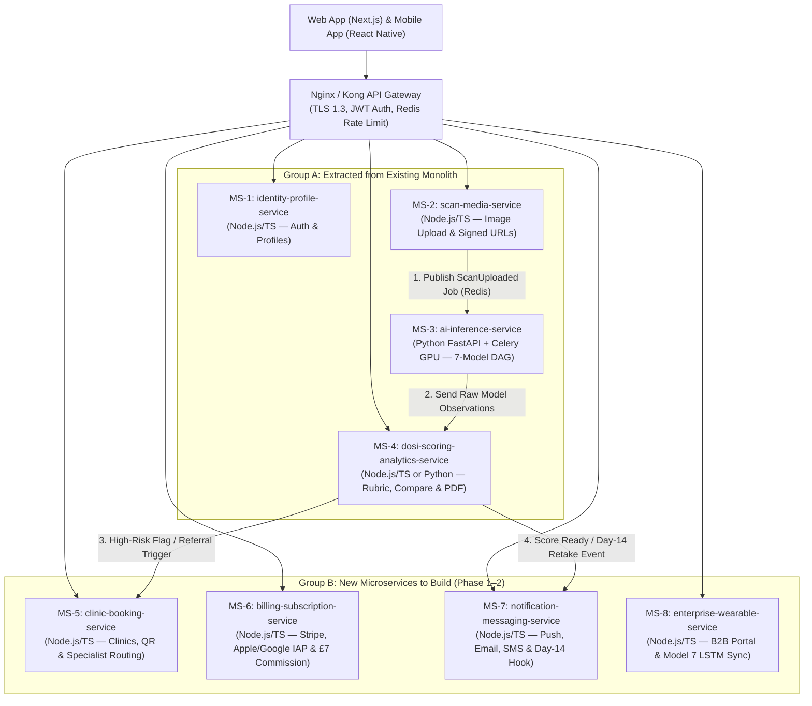

# 🧩 DentaVue — Backend Service Inventory & Monolith-to-Microservices Blueprint

**Last Updated:** November 2026  
**Current Backend Architecture:** Modular Node.js 22 + Express 5 + TypeScript Monolith (`DentaVue-backend/`)  
**Target Architecture:** 8 Domain Microservices + API Gateway + Async GPU Inference Queue (Appendix E of `DentaVuefinal3.pdf`)

> 🔗 **Related Documentation:**
> - **[ROADMAP_AND_TRACKER.md](./ROADMAP_AND_TRACKER.md)** — Master Phase-by-Phase Roadmap & Current Status Tracker
> - **[../README.md](../README.md)** — Complete Application & Azure Terraform Infrastructure Reference
> - **[../FUNCTIONALITY.md](../FUNCTIONALITY.md)** — Non-Technical Product & User Journey Guide

---

## 📍 1. Where the Backend Is Right Now (Current State Summary)

Today, [`DentaVue-backend`](../DentaVue-backend/src/app.ts) runs as a **cleanly layered Modular Monolith** (Routes → Controllers → Services → Models + Pure Domain Scoring) inside a single Docker container (`dentavue-backend:4000`) behind `dentavue-nginx`.

* **Total Live Service Modules in Monolith:** `5` Core Services + `1` External AI Integration (`gemini.ts`) + `4` Gateway Middlewares
* **Total Live REST Endpoints:** `16` (`1` healthcheck + `10` auth + `1` profile + `4` scan/analysis/comparison)
* **Total Database Tables & Buckets:** `6` PostgreSQL tables (`auth.users`, `profiles`, `scans`, `scan_images`, `scan_analysis`, `scan_parameters`, `scan_annotations`) + `1` private Storage bucket (`scans`)
* **Microservices Extracted So Far:** `0 / 8` *(Currently at **Stage 0: Modular Monolith Ready for Extraction**)*

---

## 🗂️ 2. Inventory of Services Currently Present in `DentaVue-backend`

Every module below is **already implemented and running in production** inside the monolith and maps directly to a future microservice:

| # | Current Service Module | Status | Monolith Source Files | Live API Endpoints (`/v1`) | Database Tables / Storage Owned | Current Responsibility |
|---|---|---|---|---|---|---|
| **1** | **Identity & Authentication Service** | ✅ **LIVE IN MONOLITH** | • [`routes/v1/auth.routes.ts`](../DentaVue-backend/src/routes/v1/auth.routes.ts)<br>• [`controllers/auth.controller.ts`](../DentaVue-backend/src/controllers/auth.controller.ts)<br>• [`services/auth.service.ts`](../DentaVue-backend/src/services/auth.service.ts)<br>• [`validators/auth.validator.ts`](../DentaVue-backend/src/validators/auth.validator.ts)<br>• [`utils/cookies.ts`](../DentaVue-backend/src/utils/cookies.ts) | • `POST /auth/signup`<br>• `POST /auth/signin`<br>• `POST /auth/signin-phone`<br>• `POST /auth/resend-phone-otp`<br>• `POST /auth/verify-phone-otp`<br>• `POST /auth/refresh-token`<br>• `POST /auth/session`<br>• `GET /auth/google`<br>• `POST /auth/oauth/complete`<br>• `POST /auth/logout` | • `auth.users` *(Supabase Auth)*<br>• `public.profiles` *(initial row creation)* | Email/password signup & login, SMS OTP login & verification, Google OAuth 2.0 redirect & token exchange, `httpOnly` refresh cookie management, and session revocation. |
| **2** | **User & Patient Profile Service** | ✅ **LIVE IN MONOLITH** | • [`routes/v1/profile.routes.ts`](../DentaVue-backend/src/routes/v1/profile.routes.ts)<br>• [`controllers/profile.controller.ts`](../DentaVue-backend/src/controllers/profile.controller.ts)<br>• [`services/profile.service.ts`](../DentaVue-backend/src/services/profile.service.ts)<br>• [`models/profile.model.ts`](../DentaVue-backend/src/models/profile.model.ts)<br>• [`validators/profile.validator.ts`](../DentaVue-backend/src/validators/profile.validator.ts) | • `PATCH /profile` | • `public.profiles` | Manages patient & provider profile data (`firstName`, `lastName`, `age`, `gender`, `healthConditions`, `oralGoals`, `userType`). |
| **3** | **Scan Capture & Media Storage Service** | ✅ **LIVE IN MONOLITH** | • [`routes/v1/scan.routes.ts`](../DentaVue-backend/src/routes/v1/scan.routes.ts)<br>• [`controllers/scan.controller.ts`](../DentaVue-backend/src/controllers/scan.controller.ts)<br>• [`services/scan.service.ts`](../DentaVue-backend/src/services/scan.service.ts)<br>• [`models/scan.model.ts`](../DentaVue-backend/src/models/scan.model.ts)<br>• [`validators/scan.validator.ts`](../DentaVue-backend/src/validators/scan.validator.ts) | • `POST /scans`<br>• `GET /scans` | • `public.scans`<br>• `public.scan_images`<br>• Private Bucket: `scans` | Decodes up to 4 base64 intraoral photos (`front-teeth`, `upper-gums`, `tongue`, `lower-gums`), uploads bytes to private storage with automatic rollback on failure, signs 1-hour expiring image URLs, and dispatches async AI analysis. |
| **4** | **AI Vision Analysis Pipeline Service** | ✅ **LIVE IN MONOLITH** | • [`services/analysis.service.ts`](../DentaVue-backend/src/services/analysis.service.ts)<br>• [`models/analysis.model.ts`](../DentaVue-backend/src/models/analysis.model.ts)<br>• [`integrations/gemini.ts`](../DentaVue-backend/src/integrations/gemini.ts)<br>• [`integrations/geminiPrompts.ts`](../DentaVue-backend/src/integrations/geminiPrompts.ts) | • `GET /scans/:scanId/analysis`<br>• `POST /scans/:scanId/analysis` *(reanalyse)* | • `public.scan_analysis`<br>• `public.scan_parameters`<br>• `public.scan_annotations` | Downloads private scan images into memory, executes **Pass 1 (Multimodal Vision observation + bounding boxes)**, calls `scoring.ts`, executes **Pass 2 (Clinical narrative prose)**, and persists token usage, latency, and findings. |
| **5** | **DOSI Scoring & Longitudinal Comparison Engine** | ✅ **LIVE IN MONOLITH** | • [`services/scoring.ts`](../DentaVue-backend/src/services/scoring.ts)<br>• [`services/analysis.service.ts`](../DentaVue-backend/src/services/analysis.service.ts) (`getComparison`)<br>• [`types/analysis.ts`](../DentaVue-backend/src/types/analysis.ts) | • `GET /scans/comparison`<br>• *(Internal pure scoring engine)* | • Reads `public.scan_analysis` & `public.scan_parameters` | Pure deterministic clinical rubric (`RUBRIC_VERSION = 1.1.0`): converts raw severities across 6 parameters into 4 bands (`none`, `mild`, `moderate`, `marked`) with asymmetric hysteresis, deadband filtering, confidence floors (`<40` unreadable, `<60` provisional), 0–100 DOSI score, and baseline-vs-latest scan comparison. |

### Cross-Cutting Gateway & Shared Infrastructure Currently in the Monolith
| Component | Monolith Files | Future Role in Microservices |
|---|---|---|
| **Authentication Guard** | [`middlewares/authenticate.ts`](../DentaVue-backend/src/middlewares/authenticate.ts) | Moves to **API Gateway** (JWT validation + injecting `X-User-Id` / `X-User-Role` headers to downstream services). |
| **Rate Limiting** | [`middlewares/rateLimit.ts`](../DentaVue-backend/src/middlewares/rateLimit.ts) | Moves to **API Gateway + Redis** (currently uses single-process memory store). |
| **Request Validation & Error Handling** | [`middlewares/validate.ts`](../DentaVue-backend/src/middlewares/validate.ts), [`middlewares/errorHandler.ts`](../DentaVue-backend/src/middlewares/errorHandler.ts), [`utils/ApiError.ts`](../DentaVue-backend/src/utils/ApiError.ts) | Packaged as a shared internal library (`@dentavue/common`) across all Node.js/TypeScript microservices. |
| **Structured Logging** | [`config/logger.ts`](../DentaVue-backend/src/config/logger.ts) (`pino`) | Standardized across all services with distributed `X-Correlation-Id` tracing. |

---

## 🏗️ 3. Target Microservices Architecture (8 Services to Convert / Build)

When transitioning from the monolith to microservices, the system splits into **4 Extracted Services (Group A)** from the existing codebase and **4 New Domain Services (Group B)** planned in [`routes/v1/index.ts`](../DentaVue-backend/src/routes/v1/index.ts#L20-L21) and `DentaVuefinal3.pdf`:



---

## 📋 4. Master Microservice Conversion & Build Tracker

### Group A: Services to Extract from the Current Monolith

| Target Microservice | Extraction Status | Source Files to Move from `DentaVue-backend` | Target Tech Stack | Database Ownership | Key Changes Needed During Extraction |
|---|---|---|---|---|---|
| **MS-1: `identity-profile-service`** | 🟡 **In Monolith (Ready to Split)** | • `routes/v1/auth.routes.ts`<br>• `routes/v1/profile.routes.ts`<br>• `controllers/auth.controller.ts`<br>• `controllers/profile.controller.ts`<br>• `services/auth.service.ts`<br>• `services/profile.service.ts`<br>• `models/profile.model.ts` | Node.js 22 + Express 5 + TypeScript + Supabase Auth + Redis | `auth.users`, `public.profiles`, `public.consent_records` *(new)*, `public.family_members` *(new)* | • Add missing auth routes (`/verify-email`, `/forgot-password`, `/reset-password`, `/apple`).<br>• Add UK GDPR Article 9 explicit consent tracking.<br>• Add Family Plan (`£24.99/mo`) sub-profile management. |
| **MS-2: `scan-media-service`** | 🟡 **In Monolith (Ready to Split)** | • `routes/v1/scan.routes.ts` (`POST /scans`, `GET /scans`)<br>• `controllers/scan.controller.ts`<br>• `services/scan.service.ts`<br>• `models/scan.model.ts` | Node.js 22 + Express 5 + TypeScript + Private Object Storage + HashiCorp Vault | `public.scans`, `public.scan_images`, Storage bucket `scans` | • Replace in-process `void analysisService.runAnalysis()` ([`scan.service.ts#L216`](../DentaVue-backend/src/services/scan.service.ts#L216)) with publishing a `ScanUploaded` event to **Redis (`BullMQ`/`Celery`)**.<br>• Add AES-256 field-level encryption for storage paths. |
| **MS-3: `ai-inference-service`** | 🔴 **Priority #1 Extraction** | • `services/analysis.service.ts` *(Pass 1 & Pass 2)*<br>• `integrations/gemini.ts`<br>• `integrations/geminiPrompts.ts` | **Python 3.11 + FastAPI + Celery + PyTorch / ONNX** *(GPU worker)* | Stateless worker *(reads private storage bytes, returns observations to MS-4)* | • **Extract first!** Moves heavy AI/GPU workloads out of Node.js.<br>• Runs custom clinical DAG (`YOLOv8` + `ResNet-152` + `Siamese Net` + `EfficientNet-B4` + `DenseNet-169`) while keeping `gemini.ts` logic for narrative generation & fallback. |
| **MS-4: `dosi-scoring-analytics-service`** | 🟡 **In Monolith (Pure Module)** | • `services/scoring.ts`<br>• `models/analysis.model.ts`<br>• `services/analysis.service.ts` (`getAnalysis`, `getComparison`)<br>• `routes/v1/scan.routes.ts` (`/:scanId/analysis`, `/comparison`) | Node.js 22 + TypeScript *(or Python `XGBoost` + `SHAP` service)* | `public.scan_analysis`, `public.scan_parameters`, `public.scan_annotations` | • `scoring.ts` is already 100% pure (zero I/O dependencies), making extraction effortless.<br>• Add **Model 6 `XGBoost` + `SHAP`** explainability weights.<br>• Add **1-Page Shareable Dentist PDF Report** generator (v1.5). |

---

### Group B: New Microservices to Build (From `routes/v1/index.ts` TODOs & Business Plan)

In [`DentaVue-backend/src/routes/v1/index.ts`](../DentaVue-backend/src/routes/v1/index.ts#L20-L21), the codebase lists 10 unbuilt modules:
```ts
// TODO: provider, appointments, availability, clinics, services,
// payments, notifications, reviews, search, messages
```
Here is how those 10 modules map into **4 new microservices**:

| Target Microservice | Build Status | `index.ts` TODO Modules Included | Target Phase | Proposed Endpoints | Database Tables to Create |
|---|---|---|---|---|---|
| **MS-5: `clinic-booking-service`** | ⏳ **Not Built Yet** | `provider`, `clinics`, `services`, `availability`, `appointments`, `search`, `reviews` | **Phase 1 (v1.0–v1.3)** | • `GET /v1/clinics/search`<br>• `GET /v1/clinics/:id/availability`<br>• `POST /v1/appointments`<br>• `PATCH /v1/appointments/:id/attended`<br>• `POST /v1/clinics/qr-onboard`<br>• `POST /v1/reviews` | `clinics`, `providers`, `clinic_services`, `availability_slots`, `appointments`, `qr_attributions`, `clinic_reviews` |
| **MS-6: `billing-subscription-service`** | ⏳ **Not Built Yet** | `payments`, `subscriptions`, `commissions` | **Phase 1 (v1.0)** | • `POST /v1/billing/checkout`<br>• `POST /v1/billing/webhooks/stripe`<br>• `POST /v1/billing/iap/verify` *(Apple/Google)*<br>• `GET /v1/billing/entitlements`<br>• `GET /v1/billing/practice-commissions` | `subscriptions`, `payment_transactions`, `user_entitlements`, `practice_commission_ledger` *(£7/attended booking)* |
| **MS-7: `notification-messaging-service`** | ⏳ **Not Built Yet** | `notifications`, `messages` | **Phase 1 (v1.0–v1.1)** | • `POST /v1/notifications/device-token`<br>• `GET /v1/notifications`<br>• `PATCH /v1/notifications/:id/read`<br>• `GET /v1/messages/threads`<br>• `POST /v1/messages` | `device_tokens`, `notifications`, `scheduled_reminders` *(Day-14 hook)*, `message_threads`, `messages` |
| **MS-8: `enterprise-wearable-service`** | ⏳ **Not Built Yet** | `enterprise`, `wearables` | **Phase 2 (v1.5–v2.0)** | • `GET /v1/enterprise/orgs/:id/cohort-metrics`<br>• `POST /v1/enterprise/employees/invite`<br>• `POST /v1/wearables/sync` *(Apple Health / Google Fit)*<br>• `GET /v1/wearables/correlations` | `enterprise_orgs`, `enterprise_members`, `wearable_connections`, `wearable_daily_metrics`, `dosi_wearable_correlations` |

---

## 🛠️ 5. Step-by-Step Migration Checklist (Strangler Fig Pattern)

Follow this sequence to migrate from the monolith to microservices **without downtime** on `https://www.dentavue.co.uk`:

### Stage 1: Pre-Extraction Foundation (Inside Current Repo)
- [x] **1.1 Strict Layer Separation:** Keep Controllers, Services, Models, and `scoring.ts` decoupled (already completed in `DentaVue-backend`).
- [ ] **1.2 Add Redis to `docker-compose.yml`:** Deploy `redis:7-alpine` alongside `frontend`, `backend`, and `nginx`.
- [ ] **1.3 Distributed Rate Limiting:** Switch [`middlewares/rateLimit.ts`](../DentaVue-backend/src/middlewares/rateLimit.ts) from in-memory counters to `rate-limit-redis`.
- [ ] **1.4 Queue-Backed Scan Dispatch:** Replace `void analysisService.runAnalysis(userId, scanId)` in [`scan.service.ts#L216`](../DentaVue-backend/src/services/scan.service.ts#L216) with a persistent Redis queue (`src/jobs/scanAnalysisQueue.ts`) so no scan is dropped if a container restarts.

### Stage 2: Extract `MS-3: ai-inference-service` (Phase 0 / v1.0 Prep)
- [ ] **2.1 Create `DentaVue-ai-service/` (Python FastAPI + Celery):** Consume `ScanUploaded` jobs from Redis.
- [ ] **2.2 Port Vision & Narrative Calls:** Move `Pass 1` (Vision) and `Pass 2` (Narrative) execution to the worker container.
- [ ] **2.3 Plug In Custom Clinical Models:** Load `YOLOv8` + `ResNet-152` (v1.0), `Siamese Network` (v1.1), `EfficientNet-B4` (v1.2), and `DenseNet-169` (v1.3) in the Python worker while retaining `scoring.ts` / `XGBoost` deterministic scoring.

### Stage 3: Add Revenue & Clinical Routing Services (Phase 1 / v1.0–v1.3)
- [ ] **3.1 Build `MS-6: billing-subscription-service`:** Enforce Free (1 scan/mo) vs. Premium (£9.99/mo) vs. Family (£24.99/mo) limits before `POST /v1/scans`.
- [ ] **3.2 Build `MS-5: clinic-booking-service`:** Power dental practice QR onboarding (`8` practices in Year 1) and Smart Specialist Routing (£7 attended consultation fee).
- [ ] **3.3 Build `MS-7: notification-messaging-service`:** Automate the **Day-14 Second Scan reminder** to drive free-to-paid conversion (`10% -> 12%`).

### Stage 4: Full Microservice Split at Scale (Phase 2 / `10,000+` MAU)
- [ ] **4.1 Extract `MS-2: scan-media-service` & `MS-4: dosi-scoring-analytics-service`** into independent autoscaling containers.
- [ ] **4.2 Build `MS-8: enterprise-wearable-service`** for B2B Corporate Wellness (`£4/employee/mo`) and Model 7 (`LSTM`) wearable correlations.
- [ ] **4.3 Route all `/v1/*` paths via Nginx / Kong API Gateway** to their respective microservice containers (`http://identity-service:4001`, `http://scan-service:4002`, `http://ai-service:8000`, etc.).

