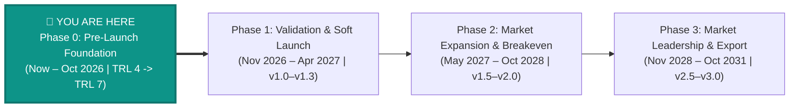

# 🗺️ DentaVue — Master Execution Roadmap, Progress Tracker & Microservices Blueprint

**Last Updated:** November 2026  
**Source Authority:** `DentaVuefinal3.pdf` (266-Page Business Plan + Appendix E Technical Specification)  
**Live Production Environment:** [https://www.dentavue.co.uk](https://www.dentavue.co.uk) (`4.234.144.53` — Azure UK South)  
**Active Unified Branch:** `feature/Mohammad`

> 💡 **Related Documentation:**
> - **[README.md](./README.md)** — Complete Application & Azure Terraform Infrastructure Reference
> - **[FUNCTIONALITY.md](./FUNCTIONALITY.md)** — Non-Technical Product & User Journey Guide

---

## 📍 1. WHERE WE ARE RIGHT NOW (Executive Status Dashboard)

### Overall Readiness Toward v1.0 Commercial Launch (Target: Nov 2026)

| Workstream | Current Status | Completion | What Is Live Today vs. What Remains for v1.0 |
|---|---|---|---|
| **1. Cloud & DevSecOps Infrastructure** | 🟢 **Live in Production** | **`65%`** | ✅ Azure UK South VM (`Standard_F1als_v7`), Static IP, NSG, Docker Compose, Nginx TLS 1.3 (`dentavue.co.uk`). ⏳ **Next:** GitHub Actions CI/CD (`GitLeaks`, `Trivy`, `Checkov`), Redis, Prometheus + Grafana, HashiCorp Vault. |
| **2. Core Backend API (`DentaVue-backend`)** | 🟢 **Live (Monolith v1)** | **`55%`** | ✅ Express 5 + TypeScript MVC, 16 REST endpoints (`/v1/auth`, `/v1/profile`, `/v1/scans`), Supabase Auth/DB/Storage, deterministic DOSI rubric (`scoring.ts`). ⏳ **Next:** Redis job queue (`BullMQ`/`Celery`), Billing/Subscriptions, Specialist Routing & Clinic Booking endpoints. |
| **3. Frontend Web PoC & Mobile App** | 🟡 **Web PoC Live** | **`40%`** | ✅ Next.js 16 + React 19 Mobile-First Web App live with 4-angle guided capture, brightness/blur gate, DOSI score, and longitudinal comparison. ⏳ **Next:** React Native (iOS & Android) wrapper or PWA offline support, on-device TFLite camera overlay, Apple IAP / Google Play Billing. |
| **4. AI Vision & Clinical Scoring Engine** | 🟡 **Gemini 2-Pass Live** | **`25%`** | ✅ 2-Pass Google Gemini Vision + Deterministic Hysteresis Scoring (`RUBRIC_VERSION 1.1.0`) with bounding boxes and confidence gates. ⏳ **Next:** Custom 7-Model Clinical DAG (`MobileNetV3` TFLite, `YOLOv8` + `ResNet-152`, `XGBoost` + `SHAP`, `Siamese Net`, `EfficientNet-B4`, `DenseNet-169`). |
| **5. Clinical Governance & UK Regulatory** | 🔴 **Pre-Submission** | **`5%`** | ✅ Non-diagnostic screening language & confidence floors enforced in code. ⏳ **Next:** Dr. Farheen Naz GDC verification, GDC Clinical Lead & 3–4 Member Advisory Panel, ICO registration, NHS Digital `DCB0129`, MHRA UKCA Class I self-certification. |
| **6. Corporate, Legal & Commercial Ops** | 🔴 **Pre-Incorporation** | **`10%`** | ✅ 266-page Business Plan & Financial Model complete. ⏳ **Next:** Companies House incorporation, 50/50 Shareholders' Agreement (£30k Owner's Fund), UK Business Bank Account, Dental Practice QR Pilot Agreements. |

---

## 🧩 2. Backend Service Inventory & Monolith-to-Microservices Tracker

This section tracks all backend services currently inside [`DentaVue-backend`](./DentaVue-backend/src/app.ts) and their planned conversion into independent microservices.

### 2.1 Services Currently Live in the Monolith (`Group A`)

| # | Service Name | Status | Current Monolith Files | Exposed Endpoints (`/v1`) | Database Tables & Storage | Target Microservice Name |
|---|---|---|---|---|---|---|
| **S1** | **Identity & Auth Service** | ✅ **LIVE** | • `src/routes/v1/auth.routes.ts` • `src/controllers/auth.controller.ts` • `src/services/auth.service.ts` • `src/validators/auth.validator.ts` | • `POST /auth/signup` • `POST /auth/signin` • `POST /auth/signin-phone` • `POST /auth/resend-phone-otp` • `POST /auth/verify-phone-otp` • `POST /auth/refresh-token` • `POST /auth/session` • `GET /auth/google` • `POST /auth/oauth/complete` • `POST /auth/logout` | • `auth.users` (Supabase) • `public.profiles` | `identity-profile-service` *(Node.js + TS)* |
| **S2** | **User & Patient Profile Service** | ✅ **LIVE** | • `src/routes/v1/profile.routes.ts` • `src/controllers/profile.controller.ts` • `src/services/profile.service.ts` • `src/models/profile.model.ts` | • `PATCH /profile` | • `public.profiles` | `identity-profile-service` *(Merged with S1)* |
| **S3** | **Scan Capture & Media Storage Service** | ✅ **LIVE** | • `src/routes/v1/scan.routes.ts` • `src/controllers/scan.controller.ts` • `src/services/scan.service.ts` • `src/models/scan.model.ts` | • `POST /scans` • `GET /scans` | • `public.scans` • `public.scan_images` • Bucket: `scans` (private) | `scan-media-service` *(Node.js + TS)* |
| **S4** | **AI Vision Analysis Service** | ✅ **LIVE** *(Gemini 2-Pass)* | • `src/services/analysis.service.ts` • `src/integrations/gemini.ts` • `src/integrations/geminiPrompts.ts` | • `GET /scans/:scanId/analysis` • `POST /scans/:scanId/analysis` | • `public.scan_analysis` • `public.scan_parameters` • `public.scan_annotations` | `ai-inference-service` *(Python FastAPI + Celery GPU)* |
| **S5** | **DOSI Scoring & Longitudinal Comparison Service** | ✅ **LIVE** *(v1.1.0 Rubric)* | • `src/services/scoring.ts` • `src/models/analysis.model.ts` • `src/services/analysis.service.ts` (`getComparison`) | • `GET /scans/comparison` • *(Internal pure scoring engine)* | • Reads `scan_analysis` & `scan_parameters` | `dosi-scoring-analytics-service` *(Node.js/TS or Python)* |

### 2.2 Planned Services to Build (`Group B` — From `routes/v1/index.ts` TODOs & Business Plan)

| # | Planned Microservice | Status | Modules Covered (`index.ts` TODOs) | Target Release | Core Scope & Business Plan Alignment |
|---|---|---|---|---|---|
| **S6** | **`clinic-booking-service`** | ⏳ **TODO** | `provider`, `clinics`, `services`, `availability`, `appointments`, `search`, `reviews` | **Phase 1 (v1.0–v1.3)** | UK partner dental clinic directory, QR code practice attribution, dentist availability slots, **Smart Specialist Routing**, and attended consultation verification (£7 commission trigger). |
| **S7** | **`billing-subscription-service`** | ⏳ **TODO** | `payments`, `subscriptions`, `commissions` | **Phase 1 (v1.0)** | Free tier vs. Individual Premium (£9.99/mo) vs. Family Plan (£24.99/mo) via Stripe / Apple IAP / Google Play Billing, plus automated £7/booking practice commission invoicing. |
| **S8** | **`notification-messaging-service`** | ⏳ **TODO** | `notifications`, `messages` | **Phase 1 (v1.0–v1.1)** | Push notifications (FCM/APNs), SMS/Email alerts, **Day-14 Second Scan retention trigger**, bi-weekly scan reminders, and secure patient-to-clinic messaging. |
| **S9** | **`enterprise-wearable-service`** | ⏳ **TODO** | `enterprise`, `wearables`, `pdf-reports` | **Phase 2 (v1.5–v2.0)** | B2B Corporate Wellness Portal (£4/employee/mo, anonymised cohort analytics `k >= 50`), 1-Page Shareable Dentist PDF Report, and **Model 7 (`LSTM`)** Apple Health / Google Fit / Health Connect sync. |

### 2.3 Microservice Extraction Checklist (Strangler Fig Migration Order)

- [x] **Step 0: Modular MVC Separation inside Monolith** — Routes, Controllers, Services, Models, and pure `scoring.ts` cleanly separated with zero circular dependencies.
- [ ] **Step 1: Introduce Redis Queue & Distributed Rate Limiting** — Add Redis container to `docker-compose.yml`; migrate `middlewares/rateLimit.ts` from memory to Redis; replace fire-and-forget `void analysisService.runAnalysis()` in `scan.service.ts` with a persistent Redis job queue (`src/jobs/`).
- [ ] **Step 2: Extract `ai-inference-service` (First Microservice Split)** — Spin up a dedicated Python FastAPI + Celery worker container consuming scan jobs from Redis so GPU model inference (`YOLOv8`, `ResNet-152`, `XGBoost`) scales independently of the Node.js API.
- [ ] **Step 3: Build `billing-subscription-service` & `clinic-booking-service`** — Add subscription entitlement checks and dental clinic booking/referral modules as isolated bounded contexts.
- [ ] **Step 4: Extract `notification-messaging-service` & `enterprise-wearable-service`** — Split background cron/notification workers and B2B enterprise analytics at `10,000+` MAU.

---

## 🧠 3. 7-Model AI Clinical Architecture Tracker (Appendix E)

| Model # | Model Name | Target Architecture (Appendix E) | Current Implementation in Repo | Target Release | Clinical Validation Target | Status |
|---|---|---|---|---|---|---|
| **Model 1** | **Image Quality & Capture Gate** | Quantised `MobileNetV3-Small` (INT8 TFLite on-device, `<50ms` per frame) | Client-side brightness/blur check + backend `USABLE_CONFIDENCE_FLOOR = 40` gate in [`scoring.ts`](./DentaVue-backend/src/services/scoring.ts) | **v1.0 (Nov 2026)** | Rejects blurry/dark/unusable frames before scoring | 🟡 **PoC Active** |
| **Model 2** | **Condition Detection & Localization** | Two-stage `YOLOv8` (bounding boxes) + `ResNet-152` (6 conditions + severity) | Pass 1 Multimodal Gemini Vision (`VISION_SYSTEM_INSTRUCTION`) with normalized `[yMin, xMin, yMax, xMax]` boxes | **v1.0 (Nov 2026)** | `>85%` sensitivity, `>80%` specificity vs. Clinical Panel | 🟡 **PoC Active** |
| **Model 6** | **DOSI Scoring Engine (0–100)** | `XGBoost` regressor + `SHAP` explainability + clinical effect-size weights | Deterministic weighted band rubric (`RUBRIC_VERSION = 1.1.0`) with asymmetric hysteresis & deadband in [`scoring.ts`](./DentaVue-backend/src/services/scoring.ts) | **v1.0 (Nov 2026)** | `>0.70` correlation with clinical periodontal indices (v2.0 study) | 🟢 **v1.1 Rubric Live** |
| **Model 5** | **Longitudinal Change Detection** | `Siamese Network` + `SIFT` keypoint alignment + `Thin-Plate Spline (TPS)` warping | Arithmetic band-delta comparison (`deriveComparison` in [`scoring.ts`](./DentaVue-backend/src/services/scoring.ts)) between baseline & latest scan | **v1.1 (Jan 2027)** | `>85%` sensitivity on paired longitudinal scans | 🟡 **v1 Arithmetic Live** |
| **Model 3** | **Nutritional Deficiency Screening** | `EfficientNet-B4` mucosal/tongue classifier (Iron, B12, Folate, Vit C/D, Zinc) | General `tissueAppearance` parameter (`15%` weight) in current rubric | **v1.2 (Feb 2027)** | `>75%` sensitivity on clinically validated mucosal dataset | 🔴 **Planned (v1.2)** |
| **Model 4** | **Oral Cancer Red-Flag Screening** | `DenseNet-169` + `Faster R-CNN` with asymmetric high-sensitivity calibration | Not yet enabled (requires clinical panel veto sign-off & urgent referral pathway) | **v1.3 (Mar 2027)** | `>88%` sensitivity (false-negative minimisation priority) | 🔴 **Planned (v1.3)** |
| **Model 7** | **Wearable & Systemic Correlation** | `LSTM` time-series network correlating DOSI trajectory with sleep/HRV/steps | Not yet built (unlocks once users accumulate `>= 6` longitudinal scans) | **v2.0 (May 2027+)** | Statistically significant correlation (`p < 0.05`) | 🔴 **Planned (v2.0)** |

---

## 📅 4. Phase-by-Phase Master Implementation Checklist

Use the checkboxes below (`[x]` = Completed, `[ ]` = Pending) to track execution progress across every phase of the Business Plan.

### 📍 PHASE 0: Pre-Launch Foundation (Now – October 2026) — *CURRENT PHASE*
**Goal:** Transition from `TRL 4` Web PoC to `TRL 7` Clinical-Grade MVP ready for UK soft launch.

#### A. Cloud Infrastructure & DevSecOps (Ali — CTO)
- [x] Provision Azure UK South infrastructure (`DentaVue-Resource-Group`, VNet, Subnet, NSG, Static Public IP `4.234.144.53`, `Standard_F1als_v7` Ubuntu 22.04 VM) via modular Terraform (`Terraform/` & `infra/`).
- [x] Configure Remote Terraform State backend in Azure Blob Storage.
- [x] Containerize Frontend (`Next.js 16 standalone`), Backend (`Express 5 + Node 22`), and Reverse Proxy (`Nginx Alpine`) via `docker-compose.yml`.
- [x] Configure Let's Encrypt TLS 1.3 SSL certificates for `dentavue.co.uk` and `www.dentavue.co.uk` with HTTP-to-HTTPS redirect.
- [x] Enable 24/7 production availability (`auto_shutdown_enabled = false`) and systemd Docker auto-restart on boot.
- [ ] Add **GitHub Actions DevSecOps Pipeline** (`.github/workflows/ci-cd.yml`) with `GitLeaks` (secret scanning), `Trivy` (container CVE scan), `Checkov` (Terraform IaC scan), and automated test runner.
- [ ] Add **Redis** container to `docker-compose.yml` for distributed rate limiting and async AI job queueing.
- [ ] Add **Prometheus + Grafana** observability stack for API latency, error rates, and container health monitoring.
- [ ] Configure **HashiCorp Vault** (or Azure Key Vault) for secrets management and field-level AES-256 health data encryption.

#### B. Application & AI Product Engineering
- [x] Build authentication flows: Email/Password signup & login, Phone SMS OTP login, Google OAuth 2.0, and HTTP-only refresh token session restoration.
- [x] Build 3-step patient onboarding & profile persistence (`firstName`, `lastName`, `age`, `gender`, `healthConditions`, `oralGoals`).
- [x] Update dashboard header branding with official **DentaVue** identity and company logo (`GreetingHeader.tsx`).
- [x] Build 4-angle guided intraoral scan capture (`front-teeth`, `upper-gums`, `tongue`, `lower-gums`) with client-side brightness & blur validation.
- [x] Implement private Supabase Storage upload with automatic rollback on partial failure and 1-hour signed URL generation.
- [x] Build 2-pass AI analysis pipeline (`analysis.service.ts`) + deterministic DOSI scoring rubric (`scoring.ts` v1.1.0) with asymmetric hysteresis and confidence gating.
- [x] Build longitudinal scan comparison (`GET /v1/scans/comparison`) comparing baseline vs. latest scan across all parameters.
- [ ] Build missing auth lifecycle endpoints noted in `auth.routes.ts`: `POST /verify-email`, `POST /forgot-password`, `POST /reset-password`, `POST /change-password`, and `GET /apple` (Sign in with Apple).
- [ ] Scaffold `ai-inference-service` (Python FastAPI + Celery) to host custom `YOLOv8` + `ResNet-152` + `XGBoost` models alongside the Gemini fallback pipeline.

#### C. Corporate, Regulatory & Clinical Governance Gates (Pre-Launch Blockers)
- [ ] **Action Item (Section 5.6.1):** Verify and record **Dr. Farheen Naz's GDC registration number** in official documentation.
- [ ] Incorporate **DentaVue Ltd** at Companies House (SIC `62012` / `86900`), execute the **50/50 Shareholders' Agreement** (recording Ali's £30,000 Owner's Fund capital), and open the UK business bank account.
- [ ] Complete **ICO Data Controller Registration** and publish UK GDPR Article 9 explicit health-data consent flows, Privacy Notice, ROPA, and DPIA.
- [ ] Complete **NHS Digital `DCB0129` Clinical Safety Officer (CSO)** training (Ali), establish the Clinical Risk Management File, Hazard Log, and Safety Case Report.
- [ ] Complete **MHRA Pre-Submission Engagement** and **UKCA Class I Medical Device Self-Certification** (under UK MDR 2002, retaining screening-only non-diagnostic boundaries).
- [ ] Contract the **GDC-Registered Clinical Lead** (`£800/mo` fractional) and recruit the **3–4 Member Clinical Advisory Panel** (`>85%` concordance gate on 100+ unseen test images).
- [ ] Convert dental practice Letters of Intent (LOIs) into signed **Dual-Capture Clinical Image Collection & Pilot Agreements** (`£3` per annotated image pair; target `5,000–8,000` UK images).

---

### 🚀 PHASE 1: Validation & Soft Launch (November 2026 – April 2027 | Months 1–6)
**Financial & Commercial Targets:** `3,500` total users | `350` paying subscribers (`10%` conversion) | `8` partner dental practices | Year 1 Revenue target: `£41,105`.

- [ ] **v1.0 Commercial Soft Launch (Nov 2026):**
  - [ ] Launch consumer app (Free tier: 1 scan/month + basic DOSI; Individual Premium: `£9.99/mo` or `£95.90/yr`; Family Plan: `£24.99/mo` up to 5 members).
  - [ ] Deploy Dental Practice QR-Code Waiting-Room Onboarding (`clinic-booking-service` attribution).
  - [ ] Implement **Day-14 Second-Scan Push Notification Hook** (`notification-messaging-service`).
- [ ] **v1.1 Longitudinal Change Detection (Jan 2027):**
  - [ ] Deploy **Model 5 (`Siamese Network + SIFT + TPS Warping`)** for pixel-aligned visual change heatmaps (`>85%` sensitivity).
- [ ] **v1.2 Nutritional Deficiency Screening (Feb 2027):**
  - [ ] Deploy **Model 3 (`EfficientNet-B4`)** screening tongue/mucosal tissues for Iron, B12, Folate, Vitamin C/D, and Zinc markers (`>75%` sensitivity) with GP routing guidance.
- [ ] **v1.3 Oral Cancer Red-Flag Screening & Specialist Routing (Mar 2027):**
  - [ ] Deploy **Model 4 (`DenseNet-169 + Faster R-CNN`)** with high-sensitivity asymmetric calibration (`>88%` sensitivity) and mandatory Clinical Panel sign-off.
  - [ ] Launch **Smart Specialist Routing & Booking** (`£7` commission per attended consultation).
- [ ] **Financial Governance Check (Apr–May 2027):**
  - [ ] Monitor the **May 2027 Cash Trough (`£5,548` projected lowest cash point)**; enforce the **`£12,000` Cash Preservation Trigger** (Risk `R9`) before hiring external contractors.

---

### 📈 PHASE 2: Market Expansion & Profitability (May 2027 – October 2028 | Months 7–24)
**Financial & Commercial Targets:** Operating Breakeven in **Month 15 (Jan 2028)** at `~1,850` paying subscribers | Year 2 Revenue: `£262,150` (`£28,966` net profit) | `22,000` users | `2,640` paying (`12%` conversion) | `35` partner practices.

- [ ] **v1.5 B2B Corporate Wellness & Dentist Bridge Record (Aug–Oct 2027):**
  - [ ] Launch **Enterprise Wellness Tier (`£4/employee/month`)** with Employer Admin Dashboard and strict cohort anonymisation (`k >= 50`).
  - [ ] Launch **1-Page Shareable Dentist PDF Summary (Dental-Medical Bridge Record)** so patients can export longitudinal DOSI trends to their dentist/GP.
- [ ] **Team Scaling (Post-Revenue Gate Only):**
  - [ ] Hire Full-Stack / Mobile Developer (`£55,000` salary, Month 7 / May 2027 — gated on cash & conversion milestones).
  - [ ] Onboard Regulatory Affairs Consultant (`£1,500/mo`, Q3 2027) for **UKCA Class IIa** conformity preparation (`BSI` / `SGS` / `UL`).
  - [ ] Hire ML / Computer Vision Engineer (`£60,000`, Q4 2027) & Dental Practice Partnership Manager (`£42,000`, Q1 2028).
- [ ] **v2.0 Wearable Integration & Clinical Correlation Study (May–Oct 2028):**
  - [ ] Deploy **Model 7 (`LSTM` Wearable Correlation Engine)** integrating Apple Health, Google Fit, and Health Connect for users with `>= 6` scans.
  - [ ] Publish **DOSI Clinical Validation Study** (`200–300` patients across `5–10` UK dental practices, targeting `>0.70` correlation with clinical probing/bleeding indices).

---

### 🌍 PHASE 3: Market Leadership & Export Readiness (November 2028 – October 2031 | Years 3–5)
**Financial & Commercial Targets:** Year 3 Revenue: `£827,760` (`£279,311` net profit, `33.7%` margin, `60,000` users, `8,400` paying, `100` practices, `20` enterprise clients, `8–9` FTEs) → Year 5 Revenue: `£3.99M` (`£1.95M` net profit, `300,000` users, `18–20` FTEs).

- [ ] **UKCA Class IIa Certification:** Transition from Class I screening to Class IIa diagnostic decision-support certification via Approved Body audit (`ISO 13485` QMS).
- [ ] **NHS Innovation Service & Integrated Care Board (ICB) Pilots:** Launch preventive oral screening pilots in NHS dental desert regions.
- [ ] **Dental Insurer Partnerships:** Integrate DOSI preventive tracking with UK dental insurers (`Simplyhealth`, `Denplan`, `Bupa`, `AXA Health`).
- [ ] **v2.5–v3.0 International Expansion:** Complete EU MDR CE-marking and launch into English-speaking and European markets (Ireland, Germany, Netherlands, Australia, Canada).

---

## 📊 5. 5-Year Financial & KPI Tracking Matrix (From Business Plan Section 10)

| Metric / Milestone | Current (Phase 0) | Year 1 (FY 2026/27) | Year 2 (FY 2027/28) | Year 3 (FY 2028/29) | Year 4 (FY 2029/30) | Year 5 (FY 2030/31) |
|---|---|---|---|---|---|---|
| **Total Registered Users** | PoC Testing | `3,500` | `22,000` | `60,000` | `150,000` | `300,000` |
| **Paying Subscribers** | `0` (Pre-Launch) | `350` (`10%`) | `2,640` (`12%`) | `8,400` (`14%`) | `22,500` (`15%`) | `48,000` (`16%`) |
| **Partner Dental Practices** | LOI Stage | `8` | `35` | `100` | `220` | `400` |
| **Enterprise Clients (B2B)** | `0` | `0` | `3` (`450` lives) | `20` (`4,000` lives) | `55` | `120` |
| **Attended Specialist Bookings** | `0` | `265` (`£7` comm.) | `3,100` | `12,000` | `32,000` | `70,000` |
| **Annual Revenue** | `£0` | `£41,105` | `£262,150` | `£827,760` | `£1,984,500` | `£3,991,200` |
| **Net Profit / (Loss)** | Founder Funded (`£30k`) | `(£19,652)` | `£28,966` *(Breakeven M15)* | `£279,311` (`33.7%`) | `£812,400` (`40.9%`) | `£1,954,800` (`49.0%`) |
| **Closing Cash Balance** | `£30,000` (Budgeted) | `£10,348` *(Low: £5.5k May '27)* | `£39,314` | `£318,625` | `£1,131,025` | `£3,085,825` |

